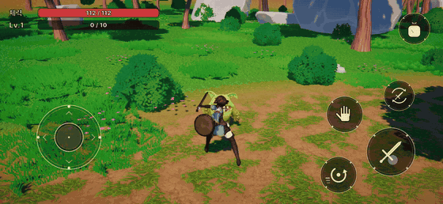
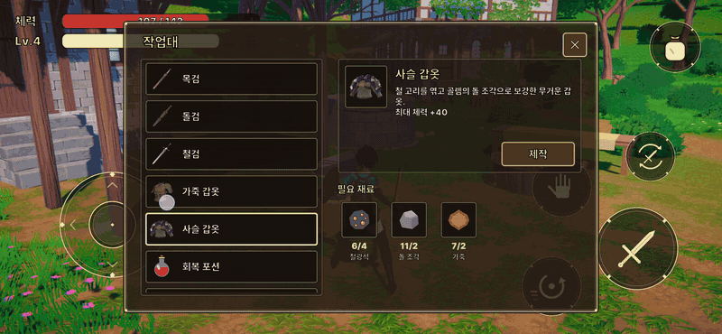
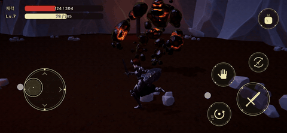
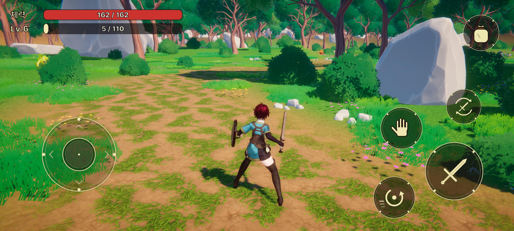
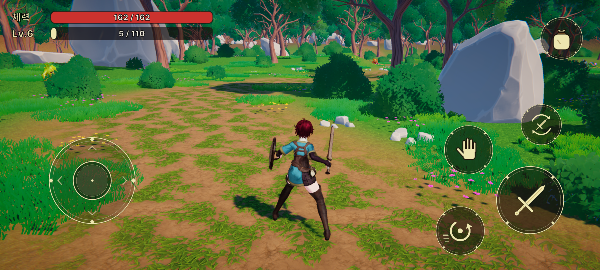
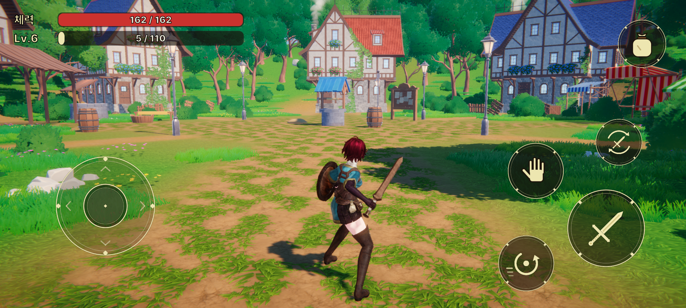
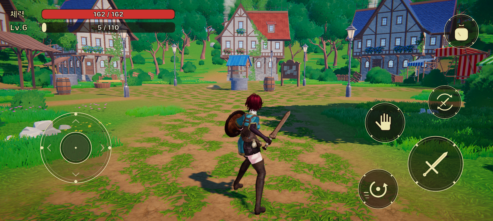
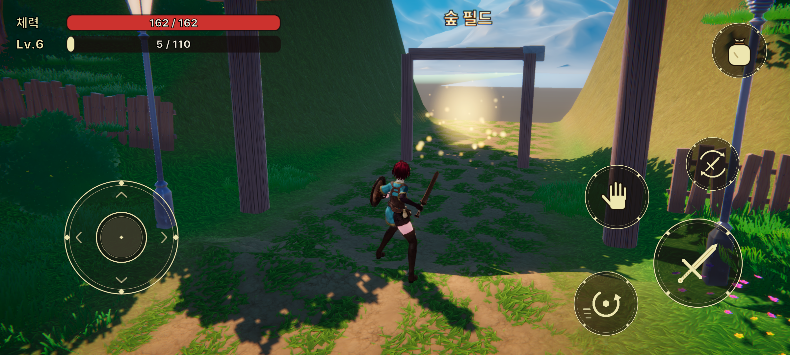
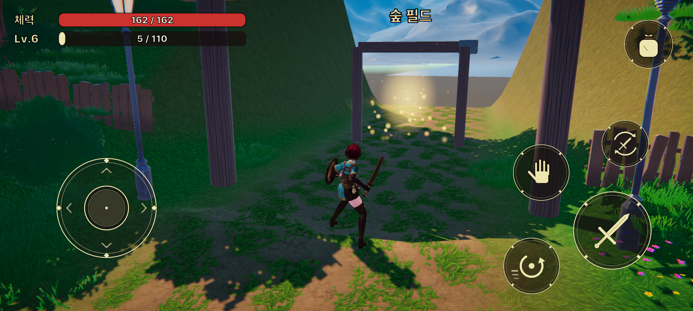

# 모험가 RPG (Adventurer RPG)

마을에서 장비를 만들고, 숲에서 재료를 모으고, 폐광의 보스를 잡는 3D 액션 RPG입니다.
Android 실기기에서 프로파일러로 병목을 찾아 줄여 나간 **모바일 최적화 과정**이 이 프로젝트의 중심입니다.

- **플레이 영상**: https://youtu.be/_4AAPZbDJ-c
- **개발**: 1인 · 2026년 9월 ~ (10/13 발표, 이후 리팩토링 · 최적화)
- **엔진**: Unity 6 (6000.5.5f1) · C# · URP · Android / PC
- **측정 기기**: Galaxy A55 5G (Exynos 1480 / Xclipse 530)

| 전투 | 제작 | 보스 처치 |
|---|---|---|
|  |  |  |

> 영상과 GIF는 **10/20 빌드**로 녹화했습니다. 아래 리팩토링 · 풀링 · 싼 블룸 적용 전 화면입니다.

> 이 저장소는 **코드 열람용**입니다. `Assets/Code`와 작업 규칙 문서, 프로파일링 기록만 들어 있고
> 씬 · 프리팹 · 아트 · 유료 에셋은 빠져 있어서 이 저장소만으로는 빌드되지 않습니다.
> 원본 저장소는 유료 에셋이 들어 있어 공개하지 않았습니다.

## 먼저 볼 코드

| 무엇 | 어디 | 한 줄 설명 |
|---|---|---|
| 모듈 조합 | `Assets/Code/Modules/` · `Assets/Code/Agents/Agent.cs` | 책임 하나당 모듈 하나, 다른 모듈은 인터페이스로 받습니다 |
| 작업 흐름 | `Assets/Code/Interactions/WorkModule.cs` | 채집 · 제작 작업 요청을 한곳에서 들고, 상호작용 모듈은 찾기 · 말풍선만 맡습니다 |
| 인벤토리 | `Assets/Code/Inventories/InventoryModule.cs` | 밖에는 읽기 전용(`IReadOnlyInventoryItem`), 넣기 전에 `CanAddItems`로 공간을 검사합니다 |
| 줍기 | `Assets/Code/Inventories/ItemCollectorModule.cs` · `Assets/Code/Items/Drops/ItemPickup.cs` | 줍기를 받을지는 플레이어 쪽이 정합니다. 가방이 차면 대기 줄에 두고 알림은 한 번만 냅니다 |
| 드랍 공유 | `Assets/Code/Items/Drops/ItemScatterSO.cs` | 적 드랍과 채집 넘침이 같은 "바닥에 뿌리기"를 씁니다 |
| 장비 | `Assets/Code/Equipments/EquipmentModule.cs` · `EquipSlotTableSO.cs` | 슬롯 규칙을 표 SO 하나에 모았습니다 |
| 창 뼈대 | `Assets/Code/UIs/AbstractPanel.cs` · `Assets/Code/Items/IItemAction.cs` | 창은 칸 번호만 넘기고, 버튼 행동은 아이템이 정합니다 |
| 오브젝트 풀 | `Assets/Code/Pools/` · `Assets/Code/Combats/Feedbacks/PoolingEffect.cs` | 이펙트 · 드랍 아이템 풀링, 지역을 떠나기 전 회수 |
| 저장 | `Assets/Code/GameSystems/Saves/SaveManager.cs` | 원자 저장, 깨진 파일은 따로 뺍니다 |
| 적 AI | `Assets/Code/Agents/Enemies/BT/` | Unity Behavior 그래프에서 쓰는 커스텀 노드 |

## 모바일 최적화

전체 과정과 원자료는 [`Docs/Profiling/ProfilingLog.md`](Docs/Profiling/ProfilingLog.md)에 시간순으로 있습니다.
모두 **Galaxy A55 실기기, Development Build** 측정값이며, 프레임별 값의 중앙값으로 비교했습니다.

### 1. GPU — 렌더 스케일로 병목 가르기

렌더 스케일을 해결책이 아니라 **픽셀 병목인지 가르는 도구**로 썼고, 픽셀 병목으로 진단했습니다.

| 장소 | 전 | 후 | 비고 |
|---|---|---|---|
| 숲 | 37.1ms | **30.6ms** | 중앙값 기준 30fps 목표 이내, 33ms를 넘는 프레임은 남음 |
| 마을 | 49.2ms | **36.9ms** (−25%) | 아직 33ms 초과 |

- 숨은 가구 삼각형 251k를 빼 보는 상한선 실험으로 "가려진 삼각형이 원인"이라는 가설을 기각했습니다.
- 같은 설정을 다시 재도 약 4ms 흔들려서, 그보다 작은 효과(블룸만, 모션 블러만)는 결론 내지 않았습니다.

### 2. CPU — 공격 순간 오브젝트 풀링

공격 구독자에 `ProfilerMarker`를 달아 기준값을 잰 뒤, 같은 조건 · 같은 경로로 재측정했습니다.
리팩토링과 풀링을 한 번에 넣지 않으려고 **리팩토링 커밋 → 기준값 → 풀링 → 재측정** 순서를 지켰습니다.

| 항목 | 풀링 전 | 미리 만들기 0 | 미리 만들기 3 · 6 |
|---|---|---|---|
| `AttackTrigger` Total 중앙값 (일반 공격, 맞음) | 1.31ms | 0.75ms | **0.50ms (−62%)** |
| 공격 안 `Instantiate` | 6개 모두 1회 | 7개 중 3개 1회 | 0회 |

소리는 풀링하지 않았습니다. BroAudio에 자체 풀이 있고 측정값도 0.00 ~ 0.02ms였습니다.
절대값이 1ms 안쪽이라 "렉을 없앴다"가 아니라 "공격마다 생기던 생성 비용을 0회로 줄였다"고 봅니다.

### 3. 같은 외관 유지 — "끄기만 하면 최적화가 아니다"

1번이 블룸과 모션 블러를 끈 결과라, 외부 피드백을 받고 외관을 되살리는 쪽을 시험했습니다.

- **FSR 업스케일 — 시험하고 버림.** 앱 안 버튼으로 켜고 꺼서 측정한 결과 GPU가 마을 +5.3ms, 숲 +4.4ms 늘었습니다.
- **싼 블룸 — 켬.** Quarter · 반복 4 · 고품질 끔으로 켜고 끄며 측정했을 때 비용 차이가 측정 흔들림 안쪽이었습니다.
- **최종 설정**: 렌더 스케일 0.7 · 업스케일 Auto · 싼 블룸 켬 · 모션 블러 끔 · 색 보정과 톤매핑 유지.

아래는 렌더 스케일 0.85 + 블룸 · 모션 블러 켬(왼쪽)과 0.7 + 끔(오른쪽)을 같은 프레임에서 찍은 비교입니다(에디터 촬영, 싼 블룸 적용 전).

| 이전 | 최종 |
|---|---|
|  |  |
|  |  |
|  |  |

`ProfilingLog.md`에 나오는 다른 스크린샷 번호는 이 저장소에 없습니다. 위 6장만 넣었습니다.

## 출처

숨기지 않고 구분해 둡니다.

| 부분 | 출처 |
|---|---|
| 모듈 · `Agent` · FSM · 스탯 · 데미지 캐스터 · `IndexedAsset` · `AnimParamSO`의 뼈대 | 수업 프로젝트 구조에서 출발해 3D · 이 게임에 맞게 고침 |
| 오브젝트 풀 (`Assets/Code/Pools/`) | 수업 라이브러리 GondrLib에서 가져와, 최대 개수 · 꺼낸 것 추적 · 지역 이동 회수를 더함 |
| 이벤트 버스 (`Assets/Code/CoreSystem/Bus/`) | 수업 코드 |
| 수집 · 제작 첫 버전 (아이템 · 인벤토리 · 제작 · 채집 · UI) | AI 코딩 에이전트(Claude Code)가 작성 → 아래 리팩토링으로 다시 짬 |

### 누가 무엇을 했나

| 작업 | 본인 | Claude Code |
|---|---|---|
| 수집 · 제작 다시 짜기 7묶음, 잠복 버그 | 구조 선택(A/B안) 전부, 코드 대부분 | 단계별 가이드 · 리뷰, 뷰 · 프리팹 연결, 일부 단계 코드 |
| 오브젝트 풀 | 범위 결정, 1 · 2단계 코드, 측정 해석 | 3 ~ 9단계 코드, 에셋 · 씬 연결, 캡처 숫자 추출 |
| GPU 최적화 | 병목 진단, 실험 계획, 결과 해석, 채택 판단 | 설정 변경, 측정 값 추출, 최종 조합 제안(1차), 비교용 토글 버튼 |
| 코드 정리 (이름 · 주석 · 형식) | 결정 승인 | 수정 전부 |

## AI 에이전트와 개발한 방식

[`CLAUDE.md`](CLAUDE.md)와 [`Assets/Code/CLAUDE.md`](Assets/Code/CLAUDE.md)가 에이전트가 작업 때마다 읽는 **규칙 문서**입니다.
코드 수정 전 사용자 확인, 설계 관례, 컨벤션, 디버깅 절차가 들어 있습니다.

단계마다 [`cs-review`](.claude/skills/cs-review/SKILL.md)로 리뷰하고 → 지적을 반영하고 → 컴파일하고 → 직접 플레이로 확인한 뒤 커밋했습니다.
리뷰에서 실제로 잡은 예로 채집 보상 넘침 개수가 누적되는 버그, 장비 불러오기 버그가 있습니다.

## 알려진 문제 / 다음 계획

포트폴리오에 쓸 수 있는 범위까지만 리팩토링하고 멈췄습니다. 남은 것은 숨기지 않고 적어 둡니다.

- **공격 코드 복붙**: 캐릭터와 적 공격이 같은 흐름(전투 시간 · 공격 목록 · 쿨다운 · 트리거 구독)을 따로 들고 있고 이미 어긋났습니다.
  중복 번호를 캐릭터는 `Debug.Assert`, 적은 `LogError`로 처리하고, 콤보 넉백 값이 없을 때 동작도 다릅니다.
  대상은 `CharacterAttackModule` ↔ `EnemyAttackModule`, `AbstractCharacterAttack` ↔ `AbstractEnemyAttack`, `ComboAttack` ↔ `CommonMeleeAttack`.
  공통 베이스를 뽑고 데미지 계산만 서브클래스가 덮어쓰게 할 계획입니다.
- **인터페이스로 받고 바로 캐스팅**: `AbstractCharacterAttack`이 `IAttackModule`을 `CharacterAttackModule`로 바꿔 씁니다. 다른 구현으로 바꾸면 동작이 조용히 빠집니다.
- **체력 · 사망 판정이 흩어짐**: `Character`와 `AbstractEnemy`가 각자 판정합니다. `HealthModule`로 모을 계획입니다.
- **"클립 끝" 이벤트의 출처를 모름**: 크로스페이드 중에 빠져나가는 클립의 이벤트로 방금 들어간 상태가 끝날 수 있습니다. 지금은 블렌드 없이 재생해서 드러나지 않습니다.
- **그 밖**: FSM 상태의 반복 코드, UI 문구 · 색 하드코딩, 튜닝값 상수, 스폰 지점 문자열 반복.
- **성능**: 마을은 일부 프레임이 여전히 33ms를 넘습니다(모듈식 건물 Overdraw 후보, 미검증). 처음 나온 공격 · 피격 · 채집 프레임의 Self 튐(3 ~ 6ms)은 풀링으로 줄지 않았습니다. `targetFrameRate`는 아직 정하지 않았습니다.

## 의존성 (이 저장소에 포함되지 않음)

Unity Behavior · Cinemachine · Input System · URP · TextMesh Pro · BroAudio
